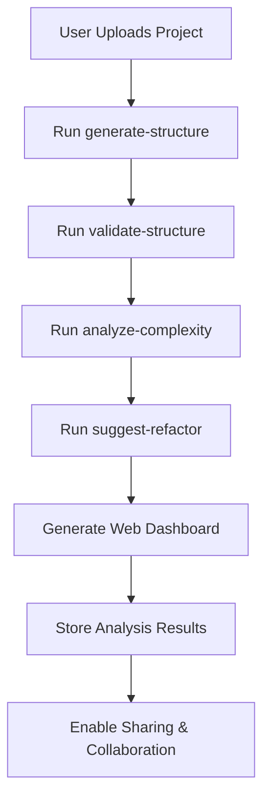

# InitRepo CLI - Ecosystem Integration Guide

## Overview

The InitRepo CLI is the cornerstone tool of the InitRepo ecosystem, designed to provide comprehensive codebase analysis and management capabilities that power multiple platforms and services. This document explains how the CLI integrates with and supports the broader InitRepo ecosystem.

## InitRepo Ecosystem Components

### 1. InitRepo CLI (This Tool)
The command-line interface that provides direct access to all analysis and modification capabilities.

### 2. InitRepo MCP Server
A Model Context Protocol server that exposes CLI functionality to AI assistants like Claude, enabling seamless AI-powered codebase interaction.

### 3. InitRepo.com Platform
A web-based platform for project documentation, analysis sharing, and collaboration built on top of CLI capabilities.

## Architecture & Design Philosophy

### Core Design Principles

1. **AI-First Architecture**: Every command provides structured JSON output optimized for AI consumption
2. **Modular Command Structure**: Commands are organized into logical phases with clear responsibilities
3. **Multi-Language Support**: Intelligent parsing with AST for precision and regex fallbacks for broad compatibility
4. **Safety by Design**: Dry-run modes and comprehensive validation for all modification operations
5. **Extensible Framework**: Plugin-like architecture enabling easy addition of new analysis types

### Command Organization

```
InitRepo CLI v2.0
├── Core Analysis (Legacy)
│   ├── analyze (default)        # Complete codebase extraction
│   ├── scaffold               # Project bootstrapping
│   └── --init                 # Configuration setup
├── Phase 1: Advanced Code Analysis
│   ├── analyze-imports        # Import/export analysis
│   ├── find-references        # Symbol usage detection
│   └── analyze-complexity     # Code complexity metrics
├── Phase 2: Safe Code Modifications
│   ├── safe-rename           # AST-based symbol renaming
│   ├── manage-imports        # Import statement management
│   └── apply-template        # Code template insertion
├── Phase 3: Project Structure Management
│   ├── generate-structure    # Architecture documentation
│   ├── validate-structure    # Best practices validation
│   └── suggest-refactor      # Refactoring recommendations
└── AI Integration Commands
    ├── deps                  # Dependency analysis
    ├── find-symbol          # Symbol search
    ├── get-code             # Code extraction
    └── tasks                # Task management
```

## InitRepo MCP Server Integration

### How the MCP Server Uses CLI Commands

The InitRepo MCP Server acts as a bridge between AI assistants and the CLI, enabling natural language interaction with codebase analysis and modification capabilities.

#### Command Mapping

```typescript
// MCP Server Tool Definitions
const tools = [
  // Analysis Tools
  {
    name: "analyze_imports",
    description: "Analyze import statements and detect issues",
    inputSchema: { /* maps to CLI --format=json options */ }
  },
  {
    name: "find_references", 
    description: "Find symbol usage across codebase",
    inputSchema: { /* maps to CLI search parameters */ }
  },
  {
    name: "suggest_refactoring",
    description: "Get intelligent refactoring suggestions", 
    inputSchema: { /* maps to CLI filtering options */ }
  },
  // Modification Tools (with safety checks)
  {
    name: "rename_symbol",
    description: "Safely rename symbols across files",
    inputSchema: { /* includes dry-run validation */ }
  }
  // ... additional tools
];
```

#### Safety & Validation Pipeline

```typescript
// MCP Server Safety Pipeline
async function executeModification(command: string, args: any) {
  // 1. Always run dry-run first
  const dryRunResult = await cli.execute(`${command} --dry-run --format=json`, args);
  
  // 2. Validate changes with user
  const confirmation = await requestUserConfirmation(dryRunResult.preview);
  
  // 3. Execute actual modification if approved
  if (confirmation.approved) {
    return await cli.execute(`${command} --format=json`, args);
  }
  
  return { cancelled: true, reason: confirmation.reason };
}
```

### JSON Response Format Standardization

All CLI commands follow a consistent JSON response format optimized for AI parsing:

```json
{
  "success": true,
  "command": "analyze-imports", 
  "timestamp": "2024-12-28T10:30:00Z",
  "data": {
    // Command-specific results
  },
  "metadata": {
    "filesAnalyzed": 150,
    "processingTime": 2.3,
    "version": "2.0.0"
  },
  "errors": [], 
  "warnings": []
}
```

## InitRepo.com Platform Integration

### How the Platform Leverages CLI Capabilities

The InitRepo.com platform uses CLI commands to provide web-based project analysis and documentation services.

#### Project Onboarding Pipeline



#### Platform Features Powered by CLI

1. **Project Health Dashboard**
   - Uses `validate-structure` for compliance scoring
   - Uses `analyze-complexity` for code quality metrics
   - Uses `suggest-refactor` for improvement recommendations

2. **Interactive Documentation**
   - Uses `generate-structure` for architecture visualization
   - Uses `find-references` for symbol cross-referencing
   - Uses `analyze-imports` for dependency mapping

3. **Collaboration Tools**
   - Uses `safe-rename` suggestions for refactoring discussions
   - Uses `apply-template` for code standardization
   - Uses `manage-imports` for cleanup automation

#### API Integration Pattern

```javascript
// InitRepo.com API Service
class InitRepoAnalysisService {
  async analyzeProject(projectId: string) {
    const results = {
      structure: await this.runCLI('generate-structure', { format: 'json' }),
      validation: await this.runCLI('validate-structure', { format: 'json' }), 
      complexity: await this.runCLI('analyze-complexity', { format: 'json' }),
      refactoring: await this.runCLI('suggest-refactor', { format: 'json' })
    };
    
    return this.generateDashboard(results);
  }
  
  private async runCLI(command: string, options: any) {
    return await exec(`initrepo-cli ${command}`, {
      cwd: this.getProjectPath(projectId),
      ...options
    });
  }
}
```

## Development Workflow Integration

### IDE Extensions & Editor Plugins

The CLI's structured output enables rich IDE integrations:

```typescript
// VS Code Extension Example
export class InitRepoExtension {
  async showComplexityProblems() {
    const result = await runCLI('analyze-complexity', { 
      threshold: 10, 
      format: 'json' 
    });
    
    // Create VS Code diagnostics from CLI output
    const diagnostics = result.data.complexityIssues.map(issue => ({
      range: new vscode.Range(issue.line - 1, 0, issue.line - 1, 100),
      message: `High complexity (${issue.complexity}): ${issue.suggestion}`,
      severity: vscode.DiagnosticSeverity.Warning
    }));
    
    this.diagnosticCollection.set(document.uri, diagnostics);
  }
}
```

### CI/CD Pipeline Integration

```yaml
# GitHub Actions Example
name: InitRepo Code Quality Check
on: [push, pull_request]

jobs:
  code-quality:
    runs-on: ubuntu-latest
    steps:
      - uses: actions/checkout@v3
      - uses: actions/setup-node@v3
        with:
          node-version: '18'
          
      - name: Install InitRepo CLI
        run: npm install -g initrepo-cli
        
      - name: Validate Project Structure
        run: |
          initrepo-cli validate-structure --format=json > validation-results.json
          echo "VALIDATION_SCORE=$(cat validation-results.json | jq '.data.score')" >> $GITHUB_ENV
          
      - name: Check Complexity
        run: |
          initrepo-cli analyze-complexity --threshold=15 --format=json > complexity-results.json
          HIGH_COMPLEXITY=$(cat complexity-results.json | jq '.data.summary.highPriority')
          if [ "$HIGH_COMPLEXITY" -gt 0 ]; then
            echo "❌ Found $HIGH_COMPLEXITY high complexity issues"
            exit 1
          fi
          
      - name: Generate Structure Report
        run: |
          initrepo-cli generate-structure --format=json > structure-report.json
          initrepo-cli suggest-refactor --min-severity=medium --format=json > refactor-suggestions.json
          
      - name: Comment PR with Results
        uses: actions/github-script@v6
        with:
          script: |
            const validation = require('./validation-results.json');
            const refactoring = require('./refactor-suggestions.json');
            
            const comment = `
            ## 📊 InitRepo Code Quality Report
            
            **Structure Validation Score:** ${validation.data.score}/${validation.data.maxScore} (${Math.round(validation.data.score/validation.data.maxScore*100)}%)
            
            **Refactoring Suggestions:** ${refactoring.data.summary.totalSuggestions}
            - High Priority: ${refactoring.data.summary.highPriority}
            - Medium Priority: ${refactoring.data.summary.mediumPriority}
            
            [View full analysis on InitRepo.com](https://initrepo.com/analysis/${context.repo.owner}/${context.repo.repo}/${context.sha})
            `;
            
            github.rest.issues.createComment({
              issue_number: context.issue.number,
              owner: context.repo.owner,
              repo: context.repo.repo,
              body: comment
            });
```

## Advanced Use Cases & Patterns

### Custom Analysis Workflows

```bash
#!/bin/bash
# initrepo-health-check.sh - Comprehensive project health analysis

echo "🔍 Running InitRepo Health Check..."

# 1. Basic validation
echo "📋 Validating project structure..."
VALIDATION=$(initrepo-cli validate-structure --format=json)
SCORE=$(echo $VALIDATION | jq '.data.score')
echo "Structure Score: $SCORE/100"

# 2. Import hygiene
echo "📦 Checking import hygiene..."
UNUSED_IMPORTS=$(initrepo-cli analyze-imports --unused-only --format=json | jq '.data.unusedImports | length')
echo "Unused imports found: $UNUSED_IMPORTS"

# 3. Complexity analysis
echo "🔥 Analyzing complexity..."
HIGH_COMPLEXITY=$(initrepo-cli analyze-complexity --threshold=10 --format=json | jq '.data.summary.highPriority')
echo "High complexity functions: $HIGH_COMPLEXITY"

# 4. Generate recommendations
echo "💡 Generating recommendations..."
initrepo-cli suggest-refactor --min-severity=medium --format=json > recommendations.json
SUGGESTIONS=$(cat recommendations.json | jq '.data.summary.totalSuggestions')
echo "Total suggestions: $SUGGESTIONS"

# 5. Generate final report
echo "📄 Generating health report..."
cat << EOF > project-health.md
# Project Health Report

Generated: $(date)

## Summary
- Structure Score: $SCORE/100
- Unused Imports: $UNUSED_IMPORTS  
- High Complexity Functions: $HIGH_COMPLEXITY
- Refactoring Suggestions: $SUGGESTIONS

## Next Steps
$(cat recommendations.json | jq -r '.data.summary | to_entries[] | "- \(.key): \(.value)"')

## Detailed Analysis
Run \`initrepo-cli generate-structure --format=tree\` for complete project overview.
EOF

echo "✅ Health check complete! Report saved to project-health.md"
```

### Multi-Project Analysis

```javascript
// analyze-workspace.js - Analyze multiple projects
const { exec } = require('child_process');
const path = require('path');
const fs = require('fs');

async function analyzeWorkspace(workspacePath) {
  const projects = fs.readdirSync(workspacePath)
    .filter(dir => fs.statSync(path.join(workspacePath, dir)).isDirectory())
    .filter(dir => fs.existsSync(path.join(workspacePath, dir, 'package.json')));

  const results = {};
  
  for (const project of projects) {
    console.log(`📊 Analyzing ${project}...`);
    const projectPath = path.join(workspacePath, project);
    
    try {
      const [structure, validation, complexity] = await Promise.all([
        runCLI('generate-structure', projectPath),
        runCLI('validate-structure', projectPath), 
        runCLI('analyze-complexity', projectPath)
      ]);
      
      results[project] = {
        structure: JSON.parse(structure),
        validation: JSON.parse(validation),
        complexity: JSON.parse(complexity),
        health_score: calculateHealthScore(structure, validation, complexity)
      };
    } catch (error) {
      results[project] = { error: error.message };
    }
  }
  
  generateWorkspaceReport(results);
}

function calculateHealthScore(structure, validation, complexity) {
  const structureScore = validation.data.score / validation.data.maxScore * 100;
  const complexityPenalty = complexity.data.summary.highPriority * 5;
  const importScore = structure.data.project.dependencies.analysis.totalCount < 100 ? 10 : 0;
  
  return Math.max(0, Math.min(100, structureScore - complexityPenalty + importScore));
}
```

## Best Practices for Integration

### 1. Error Handling

```typescript
async function safeCliExecution(command: string, options: any) {
  try {
    const result = await exec(`initrepo-cli ${command} --format=json`, options);
    const parsed = JSON.parse(result);
    
    if (!parsed.success) {
      throw new Error(`CLI command failed: ${parsed.error}`);
    }
    
    return parsed;
  } catch (error) {
    // Log error but provide fallback
    console.error(`InitRepo CLI error: ${error.message}`);
    return {
      success: false,
      error: error.message,
      fallback: true,
      data: getDefaultResponse(command)
    };
  }
}
```

### 2. Performance Optimization

```typescript
// Cache frequently accessed results
class InitRepoCLICache {
  private cache = new Map();
  private readonly TTL = 5 * 60 * 1000; // 5 minutes
  
  async getCachedResult(command: string, projectPath: string) {
    const key = `${command}:${projectPath}`;
    const cached = this.cache.get(key);
    
    if (cached && Date.now() - cached.timestamp < this.TTL) {
      return cached.result;
    }
    
    const result = await this.executeCLI(command, projectPath);
    this.cache.set(key, {
      result,
      timestamp: Date.now()
    });
    
    return result;
  }
}
```

### 3. Progressive Enhancement

```typescript
// Graceful degradation when CLI is not available
class InitRepoService {
  async getProjectAnalysis(projectPath: string) {
    try {
      // Try full CLI analysis first
      return await this.getFullAnalysis(projectPath);
    } catch (cliError) {
      console.warn('CLI not available, falling back to basic analysis');
      return await this.getBasicAnalysis(projectPath);
    }
  }
  
  private async getBasicAnalysis(projectPath: string) {
    // Fallback analysis without CLI
    return {
      type: 'basic',
      fileCount: await this.countFiles(projectPath),
      hasPackageJson: fs.existsSync(path.join(projectPath, 'package.json')),
      message: 'Install InitRepo CLI for comprehensive analysis'
    };
  }
}
```

## Future Roadmap Integration

### Planned Ecosystem Enhancements

1. **InitRepo AI Assistant**
   - Natural language queries powered by CLI analysis
   - Automated refactoring suggestions
   - Code review automation

2. **InitRepo Marketplace**
   - Custom analysis templates powered by `apply-template`
   - Shared refactoring patterns using CLI commands
   - Community-driven best practice validation rules

3. **Enterprise Features**
   - Multi-repository analysis workflows
   - Team collaboration on refactoring suggestions
   - Integration with enterprise development tools

### CLI Evolution Path

- **Phase 4**: Testing & Quality Assurance automation
- **Phase 5**: Documentation generation and maintenance
- **Phase 6**: Advanced AI integration with context-aware suggestions

## Contributing to the Ecosystem

### Adding New Analysis Types

1. Create analyzer in `src/analyzers/`
2. Add command in `src/commands/`
3. Register in `src/main.js`
4. Update MCP server tool definitions
5. Add platform integration endpoints

### Extending MCP Server

1. Define new tool schema
2. Implement CLI command mapping
3. Add safety validation
4. Update AI prompt templates

### Platform Integration

1. Create API endpoints for new analysis
2. Design dashboard components
3. Implement sharing mechanisms
4. Add collaboration features

---

**The InitRepo CLI serves as the foundation for a comprehensive ecosystem of AI-powered development tools, enabling seamless integration between command-line efficiency, AI assistance, and collaborative development platforms.**